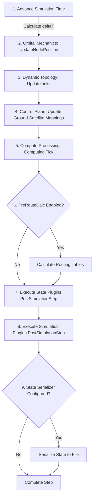

# StardustGo — Developer Documentation

## 1. Overview & Simulation Architecture

**StardustGo** is a scalable, extensible simulation framework written in Go, designed to model and evaluate distributed computation, networking, and physical dynamics across the **3D Continuum** (Ground Stations, Cloud/Edge, and Low Earth Orbit (LEO) mega-constellations).

The simulator supports evaluating mega-constellations (scaling up to tens of thousands of satellites) on a single machine with minimal memory overhead, modeling orbital mechanics, inter-satellite links (ISL), ground-to-satellite links (GSL), dynamic network routing, task orchestration, computing workloads, thermal dynamics, and battery energy harvesting/consumption.

### Modes of Operation

1. **Simulation Mode (Live Mode)**:
   - Full end-to-end execution where orbital mechanics, link topologies, physical environment (e.g. solar flux, earth shadow), and cyber-physical models are calculated at each discrete time step (`deltaT`).
   - Results can be serialized to disk via `simulationStateOutputFile` (in Go's binary `.gob` format) for future re-runs or decoupled post-processing.
2. **Precomputed Mode (Iterator Mode)**:
   - Replays previously generated orbital positions, network links, and state plugin telemetry from a `.gob` file (`simulationStateInputFile`).
   - Bypasses expensive recalculations (e.g., SGP4 orbital propagation, MST topology calculations) to quickly benchmark higher-level routing algorithms, workload generators, and deployment/orchestration strategies.

---

## 2. Project Directory Structure

```text
stardust-go-onlab/
├── README.md                          # Quickstart guide and overview
├── devdocs.md                         # Developer documentation (this document)
├── demo-results/                      # Pre-generated simulation and benchmark outputs
└── go/                                # Core Go codebase
    ├── cmd/
    │   └── stardust/                  # CLI application entry point (main.go)
    ├── configs/                       # Configuration data structures & loaders
    ├── internal/                      # Core simulator packages (internal logic)
    │   ├── analitics/                 # Telemetry metrics collection and CSV export
    │   ├── computing/                 # Node CPU / memory compute models
    │   ├── deployment/                # Task placement and orchestration strategies
    │   ├── ground/                    # Ground station builders and loaders (YAML)
    │   ├── links/                     # ISL and Ground-to-Satellite link topologies
    │   │   └── linktypes/             # Link priority queues, ISL and ground link types
    │   ├── metrics/                   # Global atomic counters & performance recorders
    │   ├── network/                   # Control plane coordinator (station-to-satellite mapping)
    │   ├── node/                      # Node models (live & precomputed satellites / ground stations)
    │   ├── routing/                   # Routing engines (Dijkstra, A*, Pre-route caches)
    │   ├── satellite/                 # Satellite constellation builders & TLE loaders
    │   ├── simplugin/                 # Simulation-step plugins (thermal, battery, workload, etc.)
    │   ├── simulation/                # Simulation controllers, step loops, serializers
    │   └── stateplugin/               # State calculation & caching plugins (solar/thermal models)
    ├── pkg/
    │   ├── helper/                    # Concurrency helpers (ParallelFor), file helpers, reset events
    │   └── types/                     # Shared interface contracts and data types
    ├── resources/                     # Simulation inputs
    │   ├── configs/                   # Sample YAML configurations (autorun, routing, physical, workload)
    │   ├── tle/                       # Two-Line Element (TLE) satellite orbit datasets
    │   └── yml/                       # Ground station coordinate definitions
    └── results/                       # Simulation run telemetry outputs and graphs
```

---

## 3. Core Simulation Lifecycle

The simulation lifecycle is managed by implementations of [`SimulationController`](file:///c:/GitHub/stardust-go-onlab/go/pkg/types/simulation_controller.go):
- [`SimulationService`](file:///c:/GitHub/stardust-go-onlab/go/internal/simulation/simulation_service.go) for live simulations.
- [`SimulationIteratorService`](file:///c:/GitHub/stardust-go-onlab/go/internal/simulation/simulation_iterator_service.go) for precomputed runs.

Both inherit common properties and step timers from [`BaseSimulationService`](file:///c:/GitHub/stardust-go-onlab/go/internal/simulation/base_simulation_service.go).

### Step Execution Sequence (`runSimulationStep`)

During each tick (`StepInterval` or manual step triggered by `StepBySeconds`/`StepByTime`), [`SimulationService.runSimulationStep`](file:///c:/GitHub/stardust-go-onlab/go/internal/simulation/simulation_service.go#L74) executes the following sequence:



1. **Advance Clock**: Advances simulation time and computes `deltaT = simTime - oldTime`. If `deltaT <= 0`, the step safely exits.
2. **Orbital Mechanics**: Executes [`n.UpdatePosition(simTime)`](file:///c:/GitHub/stardust-go-onlab/go/pkg/types/node.go#L24) concurrently over all nodes using [`helper.ParallelFor`](file:///c:/GitHub/stardust-go-onlab/go/pkg/helper/concurrency.go). For satellites, this runs SGP4 orbital propagation algorithms to update ECEF / geographic positions.
3. **Link Topology**: Calls [`n.GetLinkNodeProtocol().UpdateLinks()`](file:///c:/GitHub/stardust-go-onlab/go/pkg/types/link_node_protocol.go) concurrently to re-evaluate geometric line-of-sight, distance thresholds, and ISL / Ground connection graphs.
4. **Control Plane Mapping**: [`ControlPlaneCoordinator.UpdateMappings`](file:///c:/GitHub/stardust-go-onlab/go/internal/network/control_plane_coordinator.go) determines which satellites are currently visible and accessible to each ground station.
5. **Computing Ticks**: Calls [`comp.Tick(deltaT, simTime)`](file:///c:/GitHub/stardust-go-onlab/go/pkg/types/computing.go) on all nodes to advance executing workloads, decrement remaining task execution cycles, release completed task memory, and apply thermal load.
6. **Route Computation**: If `UsePreRouteCalc` is enabled, all nodes calculate their routing tables via [`n.GetRouter().CalculateRoutingTable()`](file:///c:/GitHub/stardust-go-onlab/go/pkg/types/router.go).
7. **State Plugins**: Executes each [`StatePlugin.PostSimulationStep`](file:///c:/GitHub/stardust-go-onlab/go/pkg/types/state_plugin.go) (calculating deterministic environmental states like solar position, sun/eclipse status, and external radiation).
8. **Simulation Plugins**: Runs each [`SimulationPlugin.PostSimulationStep`](file:///c:/GitHub/stardust-go-onlab/go/pkg/types/simulation_plugin.go) in sequence:
   - Physical models: Battery charging/discharging and thermal differential equation updates.
   - Workload generators: Creating incoming service tasks.
   - Ground station orchestrators: Placing tasks onto satellites according to the chosen strategy.
   - Telemetry exporters: Dumping telemetry metrics to disk.
9. **State Serialization**: Saves the consolidated step snapshot into binary `.gob` format if an output path was specified.

---

## 4. Main Components & Interfaces

### 4.1 Node & Satellite Representation
- **[`Node`](file:///c:/GitHub/stardust-go-onlab/go/pkg/types/node.go)**: The base interface representing any simulated entity (Satellites and Ground Stations). Exposes access to position vectors (ECEF coordinates), distances, computing resources, routers, and link protocols.
- **[`BaseNode`](file:///c:/GitHub/stardust-go-onlab/go/internal/node/base_node.go)**: Core struct shared by simulated entities.
- **[`LiveSatellite`](file:///c:/GitHub/stardust-go-onlab/go/internal/node/live_satellite.go)**: Represents an active satellite with live orbital propagation calculations (using SGP4 TLEs).
- **[`LiveGroundStation`](file:///c:/GitHub/stardust-go-onlab/go/internal/node/live_ground_station_struct.go)**: Represents a ground station with fixed coordinates on Earth's surface.
- **[`PrecomputedSatellite`](file:///c:/GitHub/stardust-go-onlab/go/internal/node/precomputed_satellite.go) / [`PrecomputedGroundStation`](file:///c:/GitHub/stardust-go-onlab/go/internal/node/precomputed_ground_station.go)**: Lightweight node representations that look up precalculated positions from serialized states.

### 4.2 Network & Routing Subsystem
- **[`Link`](file:///c:/GitHub/stardust-go-onlab/go/pkg/types/link.go)** & **[`LinkNodeProtocol`](file:///c:/GitHub/stardust-go-onlab/go/pkg/types/link_node_protocol.go)**: Manages dynamic links formed between nodes.
  - **ISL Protocols** ([`internal/links`](file:///c:/GitHub/stardust-go-onlab/go/internal/links)): Includes Minimum Spanning Tree (`isl_mst_protocol.go`), K-Nearest Neighbors (`isl_nearest_protocol.go`), Loop topologies (`isl_loop.go`, `isl_smart_loop.go`), and Path Spanning Trees (`isl_pst_protocol.go`).
  - **Ground Link Protocols**: Links ground stations to the nearest visible satellites in elevation/line-of-sight range (`ground_nearest_protocol.go`).
- **Routing Protocols** ([`internal/routing`](file:///c:/GitHub/stardust-go-onlab/go/internal/routing)):
  - **[`AStarRouter`](file:///c:/GitHub/stardust-go-onlab/go/internal/routing/astar_router.go)**: Heuristic A* algorithm using Euclidean distance in 3D ECEF space for shortest-path routing.
  - **[`DijkstraRouter`](file:///c:/GitHub/stardust-go-onlab/go/internal/routing/dijkstra_router.go)**: Standard shortest path graph routing algorithm.
  - Pre-routed caching and unreachable route handling (`preroute_result.go`, `unreachable_route_result.go`).

### 4.3 Compute & Workload Engine
- **[`Computing`](file:///c:/GitHub/stardust-go-onlab/go/pkg/types/computing.go)**: Models computing hardware capacity (CPU cores, memory, compute power).
- **Task Queues & Execution**: Nodes queue tasks and execute compute workloads across time steps, reporting CPU duty cycle and memory utilization.
- **Workload Generation**: [`WorkloadGeneratorPlugin`](file:///c:/GitHub/stardust-go-onlab/go/internal/deployment/workload_generator_plugin.go) randomly generates task batches at ground stations based on configurable intervals and seeds ([`WorkloadConfig`](file:///c:/GitHub/stardust-go-onlab/go/configs/workload_config.go)).

### 4.4 Task Orchestration Strategies
Orchestrators place computational tasks onto satellites from ground stations based on multi-objective fitness scores:
- **`coldest`** ([`strategy_coldest.go`](file:///c:/GitHub/stardust-go-onlab/go/internal/deployment/strategy_coldest.go)): Directs tasks to satellites with the lowest operational temperatures to avoid thermal throttling.
- **`sunny`** ([`strategy_sunny.go`](file:///c:/GitHub/stardust-go-onlab/go/internal/deployment/strategy_sunny.go)): Prioritizes satellites exposed to direct sunlight with surplus solar power generation.
- **`dark`** ([`strategy_dark.go`](file:///c:/GitHub/stardust-go-onlab/go/internal/deployment/strategy_dark.go)): Places workloads onto satellites in Earth's shadow/eclipse.
- **`fastest_cooling`** ([`fastest_cooling.go`](file:///c:/GitHub/stardust-go-onlab/go/internal/deployment/fastest_cooling.go)): Identifies satellites entering eclipse or radiating heat efficiently.
- **`anywhere`** ([`strategy_anywhere.go`](file:///c:/GitHub/stardust-go-onlab/go/internal/deployment/strategy_anywhere.go)): Simple fallback policy based on available resource capacity.

### 4.5 Cyber-Physical Simulation & Plugins
StardustGo features a two-tiered plugin architecture:
1. **[`StatePlugin`](file:///c:/GitHub/stardust-go-onlab/go/pkg/types/state_plugin.go)**:
   - Designed for deterministic environmental phenomena that depend only on simulation time and geometry (e.g., [`ThermalEnvironmentStatePlugin`](file:///c:/GitHub/stardust-go-onlab/go/internal/stateplugin/thermal_environment_state_plugin.go), [`DummySunStatePlugin`](file:///c:/GitHub/stardust-go-onlab/go/internal/stateplugin/dummy_sun_state_plugin.go)).
   - In live mode, computes values and saves them into precomputed output files.
   - In precomputed mode, reads pre-calculated environmental tables directly without recomputing orbital sun angles.
2. **[`SimulationPlugin`](file:///c:/GitHub/stardust-go-onlab/go/pkg/types/simulation_plugin.go)**:
   - Runs every simulation step to model dynamic cyber-physical states and feedback loops:
     - **[`BatterySimPlugin`](file:///c:/GitHub/stardust-go-onlab/go/internal/simplugin/battery_sim_plugin.go)**: Tracks State of Charge (SoC), solar energy harvesting, idle draw, CPU compute consumption, and link transmission energy per byte.
     - **[`ThermalSimPlugin`](file:///c:/GitHub/stardust-go-onlab/go/internal/simplugin/thermal_sim_plugin.go)**: Models internal dissipation from electronics, solar absorptivity, and radiative cooling in space via Stefan-Boltzmann radiation laws.
     - **[`PhysicalPluginCoordinator`](file:///c:/GitHub/stardust-go-onlab/go/internal/simplugin/physical_plugin_coordinator.go)**: Binds battery and thermal models for cyber-physical feedback loops.
     - **[`TelemetryExporterPlugin`](file:///c:/GitHub/stardust-go-onlab/go/internal/analitics/telemetry_plugin.go)**: Asynchronously flushes per-node and per-network CSV telemetry records to `./results/analytics`.

---

## 5. Configuration & Extension Guide

### 5.1 Configuration Files
Configurations are located in `./go/resources/configs/`:
- **`simulationConfig.yaml`**: Configures simulation step parameters (`StepInterval`, `StepMultiplier`, `StepCount`), simulation start time, data source files, and pre-route calculations.
- **`islConfig.yaml`**: Configures ISL algorithm (`mst`, `nearest`, `smart_loop`) and neighbor count limits.
- **`groundLinkConfig.yaml`**: Configures ground station connection protocols.
- **`computingConfig.yaml`**: Declares compute node capacities (core counts, memory capacity, Edge vs Cloud categorization).
- **`routerConfig.yaml`**: Specifies router algorithm (`astar`, `dijkstra`).
- **`workloadConfig.yaml`**: Tunes task generation rate, payload byte sizes, CPU cycles, and random seeds.
- **`physicalConfig.yaml`**: Configures thermal mass, solar panel efficiency, battery capacities, and Stefan-Boltzmann constants.

### 5.2 How to Add a New Orchestration Strategy
1. Create a new strategy file in `go/internal/deployment/`:
   ```go
   package deployment

   type CustomStrategy struct{}

   func (s *CustomStrategy) Evaluate(
       source types.Node,
       target types.Satellite,
       task types.DeployableService,
       sunPlugin stateplugin.SunStatePlugin,
       thermalPlugin *simplugin.ThermalSimPlugin,
       batteryPlugin *simplugin.BatterySimPlugin,
   ) float64 {
       // Return fitness score between 0.0 and 1.0 (or -1.0 if ineligible)
       return 0.85
   }
   ```
2. Register the strategy in [`GetStrategy`](file:///c:/GitHub/stardust-go-onlab/go/internal/deployment/strategy.go#L23) in `go/internal/deployment/strategy.go`.
3. Pass `--orchestrator custom` when running the application.

### 5.3 How to Add a New Simulation Plugin
1. Implement the [`SimulationPlugin`](file:///c:/GitHub/stardust-go-onlab/go/pkg/types/simulation_plugin.go) interface:
   - `Name() string`
   - `PostSimulationStep(controller types.SimulationController) error`
2. Register the plugin constructor in [`PluginBuilder`](file:///c:/GitHub/stardust-go-onlab/go/internal/simplugin/plugin_builder.go).
3. Activate the plugin via `--simulationPlugins <plugin-name>`.

---

## 6. How to Build and Run

### Build
```bash
cd go
go build -o stardust.exe ./cmd/stardust
```

### Run Live Simulation
```bash
./stardust.exe \
  --simulationConfig ./resources/configs/simulationAutorunConfig.yaml \
  --islConfig ./resources/configs/islMstConfig.yaml \
  --groundLinkConfig ./resources/configs/groundLinkNearestConfig.yaml \
  --computingConfig ./resources/configs/computingConfig.yaml \
  --routerConfig ./resources/configs/routerAStarConfig.yaml \
  --orchestrator coldest \
  --simulationStateOutputFile ./simulation_state_output.gob
```

### Run Precomputed Simulation
```bash
./stardust.exe \
  --simulationConfig ./resources/configs/simulationAutorunConfig.yaml \
  --computingConfig ./resources/configs/computingConfig.yaml \
  --routerConfig ./resources/configs/routerAStarConfig.yaml \
  --orchestrator coldest \
  --simulationStateInputFile ./simulation_state_output.gob
```
